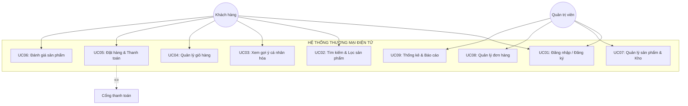
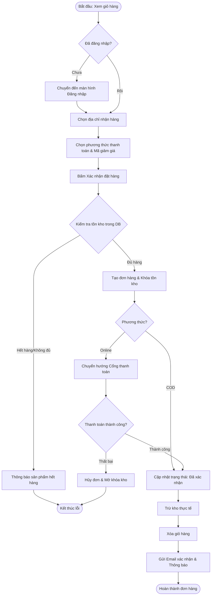
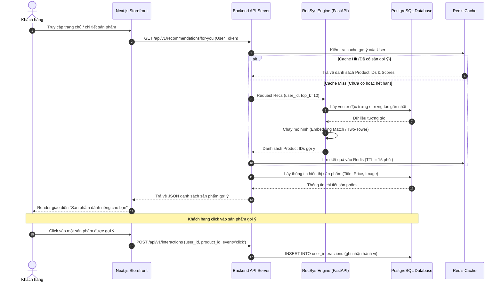
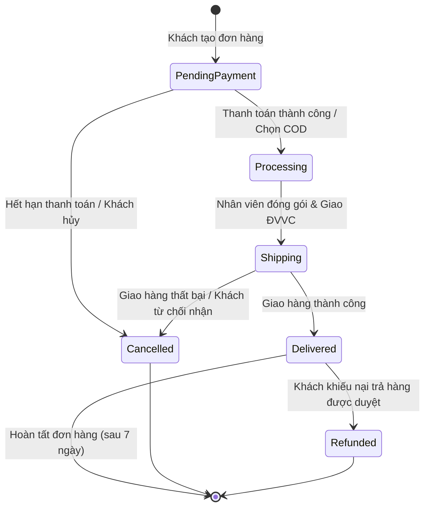
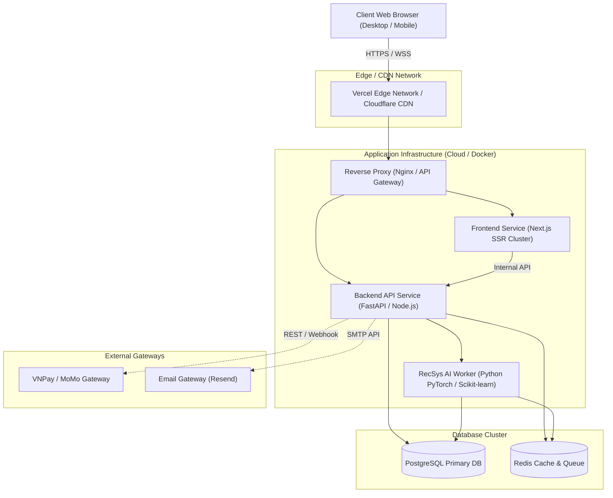

# BÁO CÁO PHÂN TÍCH VÀ THIẾT KẾ HỆ THỐNG (PTTKHT)
## ĐỀ TÀI: HỆ THỐNG THƯƠNG MẠI ĐIỆN TỬ TÍCH HỢP HỆ THỐNG GỢI Ý CÁ NHÂN HÓA (E-COMMERCE & RECSYS)

---

## CHƯƠNG 1: KHẢO SÁT HIỆN TRẠNG & XÁC ĐỊNH BÀI TOÁN

### 1.1. Đặt vấn đề & Khảo sát hiện trạng
Trong bối cảnh bùng nổ thương mại số, các hệ thống bán lẻ trực tuyến đối mặt với tình trạng "quá tải thông tin" (Information Overload). Khách hàng gặp khó khăn khi tìm kiếm sản phẩm phù hợp giữa hàng trăm nghìn mặt hàng, dẫn đến tỷ lệ rời bỏ trang cao và giảm tỷ lệ chuyển đổi (Conversion Rate). 

### 1.2. Mục tiêu dự án
* **Mục tiêu nghiệp vụ:** Xây dựng nền tảng E-commerce hoàn chỉnh, tin cậy cho phép người dùng tìm kiếm, đặt mua, thanh toán và đánh giá sản phẩm trực tuyến.
* **Mục tiêu kỹ thuật:** 
  * Tích hợp động cơ gợi ý cá nhân hóa (**Recommendation Engine**) nhằm tăng giá trị trung bình trên mỗi đơn hàng (AOV) và thời gian người dùng tương tác trên trang.
  * Đảm bảo kiến trúc sẵn sàng mở rộng, chịu tải tốt, tính toàn vẹn giao dịch tài chính và độ trễ thấp (< 200ms cho trang chủ và < 50ms cho API gợi ý).

### 1.3. Phạm vi hệ thống (System Boundary)
Hệ thống bao gồm 3 phân hệ chính:
1. **Storefront Portal (Khách hàng):** Duyệt sản phẩm, tìm kiếm, quản lý giỏ hàng, thanh toán trực tuyến, theo dõi đơn, gửi đánh giá.
2. **Admin/Seller Portal (Quản trị viên & Nhân viên):** Quản lý danh mục, sản phẩm, tồn kho, đơn hàng, khách hàng, cấu hình khuyến mãi.
3. **Recommendation Subsystem (Phân hệ Gợi ý):** Thu thập dữ liệu hành vi (clickstream/interactions), huấn luyện mô hình và phục vụ API gợi ý thời gian thực.

---

## CHƯƠNG 2: PHÂN TÍCH YÊU CẦU HỆ THỐNG

### 2.1. Xác định Tác nhân (Actors)
* **Khách vãng lai (Guest):** Người dùng chưa xác thực, có thể xem danh mục, tìm kiếm, thêm vào giỏ hàng tạm thời.
* **Khách hàng thành viên (Customer):** Người dùng đã đăng ký/đăng nhập, có thể đặt hàng, lưu nhiều địa chỉ, thanh toán, đánh giá và nhận gợi ý cá nhân hóa.
* **Nhân viên bán hàng / Quản lý kho (Staff):** Xử lý đơn hàng, cập nhật trạng thái vận chuyển, kiểm kê số lượng tồn.
* **Quản trị viên hệ thống (Administrator):** Toàn quyền cấu hình hệ thống, quản lý người dùng, phân quyền, xem báo cáo doanh thu.
* **Hệ thống ngoài (External Systems):** Cổng thanh toán (VNPay/MoMo/Stripe), Đơn vị vận chuyển (GHN/GHTK), Dịch vụ Email (SMTP/Resend).

### 2.2. Yêu cầu chức năng (Functional Requirements - FR)

| Mã FR | Tên chức năng | Mô tả chi tiết | Tác nhân chính |
| :--- | :--- | :--- | :--- |
| **FR-01** | Quản lý Tài khoản & Định danh | Đăng ký, đăng nhập, quên mật khẩu, cập nhật hồ sơ, quản lý sổ địa chỉ. | Guest, Customer |
| **FR-02** | Quản lý Danh mục & Sản phẩm | Duyệt theo cây danh mục, lọc theo tiêu chí (giá, thương hiệu, rating), tìm kiếm full-text. | Guest, Customer, Admin |
| **FR-03** | Quản lý Giỏ hàng | Thêm, bớt, sửa số lượng, áp dụng mã giảm giá (voucher). | Guest, Customer |
| **FR-04** | Đặt hàng & Thanh toán | Chọn địa chỉ, chọn phương thức vận chuyển & thanh toán, tạo đơn hàng, trừ kho. | Customer |
| **FR-05** | Xử lý Đơn hàng (Order Fulfillment) | Xác nhận, đóng gói, bàn giao vận chuyển, hủy đơn, hoàn tiền. | Staff, Admin |
| **FR-06** | Đánh giá & Phản hồi | Chấm điểm sao (1-5), viết nhận xét kèm ảnh đối với sản phẩm đã mua. | Customer |
| **FR-07** | Gợi ý Sản phẩm thông minh | Gợi ý "Sản phẩm tương tự", "Khách hàng thường mua cùng", "Dành riêng cho bạn". | Guest, Customer |
| **FR-08** | Báo cáo & Thống kê | Thống kê doanh thu theo thời gian, sản phẩm bán chạy, tỷ lệ hủy đơn. | Admin |

### 2.3. Yêu cầu phi chức năng (Non-Functional Requirements - NFR)
* **Hiệu năng (Performance):** 
  * Thời gian phản hồi trang (Page Load Time) < 1.5 giây.
  * Tốc độ phản hồi API danh sách sản phẩm và giỏ hàng < 150ms.
  * API gợi ý sản phẩm (RecSys inference) < 50ms cho 95% requests (p95).
* **Khả năng mở rộng (Scalability):** Hệ thống thiết kế theo dạng Stateless Service, hỗ trợ Scale ngang (Horizontal Scaling) khi lưu lượng tăng đột biến (Flash Sale).
* **Bảo mật (Security):** 
  * Mã hóa mật khẩu với Bcrypt/Argon2.
  * Truyền thông qua HTTPS/TLS 1.3, xác thực người dùng bằng JWT với HTTP-Only Cookie.
  * Kiểm soát phân quyền RBAC (Role-Based Access Control).
  * Chống các lỗ hổng OWASP Top 10: SQL Injection, XSS, CSRF, Rate Limiting.
* **Tính toàn vẹn (Integrity & Reliability):** Đảm bảo tính toán đúng tồn kho và số tiền giao dịch thông qua cơ chế Database Transaction (ACID) và Concurrency Control (Optimistic/Pessimistic Locking).

---

## CHƯƠNG 3: MÔ HÌNH HÓA CHỨC NĂNG (USE CASE MODELING)

### 3.1. Sơ đồ Use Case Tổng quát (Overall Use Case Diagram)

### 3.2. Đặc tả Use Case Tiêu biểu (Use Case Specification)

#### **Đặc tả Use Case: UC05 - Đặt hàng & Thanh toán (Checkout & Order)**
* **Mã Use Case:** UC05
* **Tên Use Case:** Đặt hàng và Thanh toán
* **Tác nhân chính:** Khách hàng (Customer)
* **Tác nhân phụ:** Cổng thanh toán (Payment Gateway), Hệ thống gửi Email
* **Tiền điều kiện (Pre-conditions):** 
  * Khách hàng đã đăng nhập.
  * Giỏ hàng có ít nhất một sản phẩm còn hàng trong kho (`stock_quantity >= quantity`).
* **Hậu điều kiện (Post-conditions):**
  * Bản ghi đơn hàng (`orders`) và chi tiết đơn (`order_items`) được tạo thành công.
  * Tồn kho sản phẩm được cập nhật giảm tương ứng.
  * Giỏ hàng được xóa rỗng.
  * Email xác nhận đơn hàng được gửi tới khách hàng.
* **Luồng sự kiện chính (Main Flow / Happy Path):**
  1. Khách hàng bấm chọn "Tiến hành thanh toán" từ trang giỏ hàng.
  2. Hệ thống hiển thị thông tin tóm tắt đơn hàng, danh sách địa chỉ nhận hàng đã lưu và các phương thức thanh toán.
  3. Khách hàng chọn địa chỉ nhận hàng, phương thức vận chuyển và hình thức thanh toán (ví dụ: Thanh toán trực tuyến qua VNPay).
  4. Khách hàng nhập mã giảm giá (nếu có). Hệ thống kiểm tra điều kiện và tính lại tổng tiền.
  5. Khách hàng bấm "Xác nhận đặt hàng".
  6. Hệ thống tạo giao dịch CSDL (Transaction): kiểm tra tồn kho, khóa sản phẩm tạm thời, tạo đơn hàng ở trạng thái `pending_payment`.
  7. Hệ thống chuyển hướng khách hàng sang cổng thanh toán đối tác.
  8. Khách hàng thực hiện xác thực và thanh toán thành công trên cổng thanh toán.
  9. Cổng thanh toán gửi Webhook/IPN xác nhận giao dịch thành công cho hệ thống.
  10. Hệ thống cập nhật trạng thái đơn hàng sang `processing`, trừ tồn kho vĩnh viễn, gửi email xác nhận và hiển thị thông báo thành công cho khách hàng.
* **Luồng ngoại lệ (Alternative/Exception Flows):**
  * *E1 - Sản phẩm hết hàng:* Tại bước 6, nếu một sản phẩm trong giỏ bị người khác mua trước khiến tồn kho không đủ, hệ thống hủy Transaction, hiển thị cảnh báo: "Sản phẩm [Tên] vừa hết hàng, vui lòng cập nhật lại giỏ hàng".
  * *E2 - Thanh toán thất bại/Người dùng hủy:* Tại bước 8, nếu người dùng bấm hủy hoặc tài khoản không đủ tiền, cổng thanh toán trả về mã lỗi. Hệ thống cập nhật đơn hàng thành `cancelled` hoặc cho phép khách hàng thực hiện thanh toán lại trong vòng 15 phút.

---

## CHƯƠNG 4: THIẾT KẾ ĐỘNG (BEHAVIORAL MODELING)

### 4.1. Biểu đồ Hoạt động (Activity Diagram) - Quy trình Đặt hàng

### 4.2. Biểu đồ Tuần tự (Sequence Diagram) - Luồng Gợi ý Sản phẩm Cá nhân hóa (RecSys)

### 4.3. Biểu đồ Trạng thái (State Machine Diagram) - Vòng đời Đơn hàng

---

## CHƯƠNG 5: THIẾT KẾ KIẾN TRÚC & TRIỂN KHAI (SYSTEM ARCHITECTURE)

### 5.1. Kiến trúc Tổng thể (Layered / Micro-service Ready Architecture)
Hệ thống được thiết kế theo mô hình kiến trúc nhiều tầng (Multi-tier Architecture):
1. **Presentation Layer:** Next.js (App Router, Server-side Rendering tối ưu SEO, Tailwind CSS).
2. **API Gateway & Business Logic Layer:** RESTful API Server chịu trách nhiệm xử lý logic nghiệp vụ thương mại điện tử, bảo mật, auth, giao dịch.
3. **Data & AI Layer:** 
   * **PostgreSQL:** Lưu trữ dữ liệu quan hệ có cấu trúc và giao dịch ACID.
   * **Redis:** Caching dữ liệu đọc nhiều, rate-limiting, session.
   * **RecSys Service:** Dịch vụ Python độc lập phục vụ việc huấn luyện lại mô hình (Batch Train) và suy luận gợi ý sản phẩm (Inference API).

### 5.2. Biểu đồ Triển khai (Deployment Diagram)

---

## CHƯƠNG 6: KẾ HOẠCH TRIỂN KHAI DỰ ÁN (WBS & ROADMAP)

### 6.1. Bảng Phân rã Công việc (Work Breakdown Structure - WBS)

| Giai đoạn (Phase) | Mã công việc | Hạng mục công việc chi tiết | Sản phẩm đầu ra (Deliverable) |
| :--- | :--- | :--- | :--- |
| **Phase 1: Phân tích & Thiết kế** | 1.1 | Khảo sát bài toán, xác định FR & NFR | Tài liệu đặc tả yêu cầu (SRS) |
| | 1.2 | Thiết kế Use Case, Activity, Sequence Diagrams | Tài liệu thiết kế hệ thống |
| | 1.3 | Thiết kế CSDL quan hệ (ERD & DDL Script) | `database/schema.sql` |
| **Phase 2: Xây dựng CSDL & Datalake** | 2.1 | Cài đặt và cấu hình PostgreSQL, Indexes, Triggers | Database chạy hoàn chỉnh |
| | 2.2 | Xây dựng pipeline Ingestion dữ liệu từ Amazon dataset | Dữ liệu mẫu nạp vào CSDL |
| **Phase 3: Phát triển Backend API** | 3.1 | Khởi dựng RESTful API framework, Module Auth (JWT) | API Đăng ký / Đăng nhập |
| | 3.2 | Xây dựng API Catalog, Sản phẩm, Danh mục, Search | API Danh mục & Sản phẩm |
| | 3.3 | Xây dựng API Giỏ hàng, Đặt hàng & Xử lý Transaction kho | API Cart & Checkout |
| | 3.4 | Tích hợp cổng thanh toán Sandbox (VNPay/MoMo) | Webhook xử lý thanh toán |
| **Phase 4: Phát triển Frontend Storefront** | 4.1 | Xây dựng Layout, Header, Mega-Menu, Trang chủ | Giao diện cơ sở |
| | 4.2 | Trang danh sách sản phẩm với bộ lọc & phân trang | Catalog UI |
| | 4.3 | Trang chi tiết sản phẩm, chọn biến thể, xem review | Product Detail UI |
| | 4.4 | Trang giỏ hàng, quy trình Checkout & Lịch sử đơn hàng | Checkout & Account UI |
| **Phase 5: Xây dựng Hệ thống Gợi ý (RecSys)** | 5.1 | Thu thập log tương tác (`user_interactions`) | Tracking pipeline |
| | 5.2 | Huấn luyện mô hình Collaborative Filtering & Content-Based | Model checkpoints |
| | 5.3 | Xây dựng API phục vụ gợi ý và tích hợp vào UI | Widget gợi ý trên Web |
| **Phase 6: Kiểm thử & Đóng gói Triển khai** | 6.1 | Viết Unit Test, Integration Test và kiểm thử tải | Báo cáo kiểm thử (Test Report) |
| | 6.2 | Đóng gói Docker, cấu hình CI/CD và triển khai thực tế | Hệ thống online hoàn chỉnh |

---

## CHƯƠNG 7: KẾT LUẬN & HƯỚNG PHÁT TRIỂN

Hệ thống được thiết kế theo đúng chuẩn phương pháp luận Phân tích & Thiết kế Hệ thống Thông tin hướng đối tượng (OOAD), đảm bảo tính module hóa cao (High Cohesion, Low Coupling). Việc tích hợp sẵn bảng ghi nhận hành vi (`user_interactions`) và schema tối ưu cho RecSys là điểm cộng lớn, giúp nền tảng thương mại điện tử không chỉ đáp ứng các quy trình giao dịch cơ bản mà còn sẵn sàng cho bài toán cá nhân hóa trải nghiệm người dùng trong thực tế.

